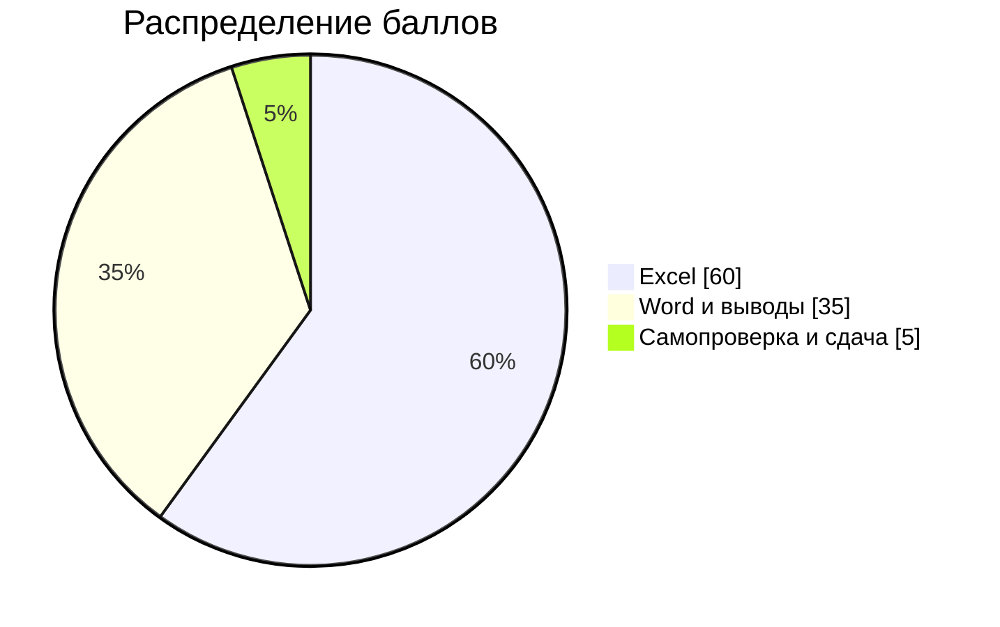

# Практическая работа по информационным технологиям

## Microsoft Excel и Microsoft Word: анализ продаж и подготовка аналитического отчёта

> **Формат:** индивидуальная практическая работа.  
> **Продолжительность:** 90 минут (2 академических часа).  
> **Уровень:** базовый / средний.  
> **Программное обеспечение:** Microsoft Excel, Microsoft Word (настольные версии 2016 или новее).  
> **Итог:** рабочая книга `.xlsx` и оформленный документ `.docx`.  
> **Максимальная оценка:** 100 баллов.

---

## 1. Цель работы

Научиться использовать электронные таблицы для обработки исходных данных, выполнения автоматических расчётов и визуализации результатов, а текстовый редактор — для подготовки структурированного делового документа на основе полученных результатов.

После выполнения работы студент должен уметь:

- создавать и форматировать таблицы Excel;
- использовать относительные ссылки, формулы и встроенные функции;
- сортировать, фильтровать и анализировать данные по условиям;
- строить и оформлять диаграммы;
- переносить результаты расчётов из Excel в Word;
- применять стили заголовков, нумерацию страниц, таблицы и автоматическое оглавление;
- формулировать выводы, подтверждённые числовыми данными;
- сохранять и сдавать документы в установленном формате.

## 2. Постановка задачи

Вы работаете в отделе аналитики магазина компьютерной техники «ТехноМаркет». Руководитель предоставил сведения о продажах за отчётный период. Необходимо определить выручку, себестоимость, валовую прибыль, наиболее доходные товары и категории, а затем подготовить аналитический отчёт для руководства.

Все данные условные и предназначены исключительно для учебной работы. Налоги, аренда, зарплата и прочие расходы не учитываются: рассчитывается **валовая прибыль**, а не чистая прибыль предприятия.


## 3. Распределение времени

| Этап | Время | Результат |
|---|---:|---|
| Подготовка файлов и ввод данных | 10 мин | Исходная таблица |
| Формулы и расчёт итогов | 20 мин | Автоматические вычисления |
| Сортировка, фильтрация и анализ | 10 мин | Сводка по категориям |
| Построение диаграмм | 10 мин | Две оформленные диаграммы |
| Подготовка отчёта Word | 30 мин | Структурированный документ |
| Проверка и сдача | 10 мин | Два готовых файла |
| **Всего** | **90 мин** | **Комплект выполненной работы** |

---

# Часть I. Microsoft Excel

## 4. Создание рабочей книги

Создайте рабочую папку `ИТ_Excel_Word_Фамилия_Группа`.

В Excel создайте книгу `Анализ_продаж_Фамилия.xlsx` с тремя листами:

| Лист | Назначение |
|---|---|
| Продажи | Исходные данные и расчёты по товарам |
| Аналитика | Общие показатели и группировка по категориям |
| Диаграммы | Графическое представление результатов |

### 4.1. Исходные данные

На листе «Продажи» в строке 1 разместите заголовки столбцов, со строки 2 введите данные. Не добавляйте строки над заголовком.

| № | Наименование | Категория | Количество, шт. | Закупочная цена, руб. | Цена продажи, руб. |
|---:|---|---|---:|---:|---:|
| 1 | Мышь проводная | Периферия | 8 | 650 | 990 |
| 2 | Клавиатура | Периферия | 5 | 1250 | 1790 |
| 3 | SSD 500 ГБ | Накопители | 4 | 2900 | 3690 |
| 4 | Кабель USB-C | Кабели | 12 | 180 | 350 |
| 5 | Флешка 32 ГБ | Накопители | 7 | 430 | 690 |
| 6 | Гарнитура | Периферия | 3 | 1800 | 2590 |
| 7 | Кабель HDMI | Кабели | 10 | 250 | 490 |
| 8 | Карта памяти 128 ГБ | Накопители | 6 | 850 | 1190 |
| 9 | Веб-камера | Периферия | 4 | 950 | 1490 |
| 10 | Кабель USB-A | Кабели | 9 | 120 | 240 |
| 11 | SSD 1 ТБ | Накопители | 2 | 4100 | 5290 |
| 12 | Коврик для мыши | Периферия | 5 | 520 | 890 |

Для быстрого ввода можно скопировать следующий блок и вставить его в ячейку A1. Значения разделены табуляцией. Если Excel поместил всё в один столбец, используйте «Данные → Текст по столбцам → С разделителями → Знак табуляции».

```text
№	Наименование	Категория	Количество, шт.	Закупочная цена, руб.	Цена продажи, руб.
1	Мышь проводная	Периферия	8	650	990
2	Клавиатура	Периферия	5	1250	1790
3	SSD 500 ГБ	Накопители	4	2900	3690
4	Кабель USB-C	Кабели	12	180	350
5	Флешка 32 ГБ	Накопители	7	430	690
6	Гарнитура	Периферия	3	1800	2590
7	Кабель HDMI	Кабели	10	250	490
8	Карта памяти 128 ГБ	Накопители	6	850	1190
9	Веб-камера	Периферия	4	950	1490
10	Кабель USB-A	Кабели	9	120	240
11	SSD 1 ТБ	Накопители	2	4100	5290
12	Коврик для мыши	Периферия	5	520	890
```

### 4.2. Оформление таблицы

1. Добавьте пять расчётных столбцов G–K согласно следующему разделу.
2. Выделите диапазон A1:K13 и преобразуйте его в таблицу сочетанием `Ctrl+T`. Установите флажок «Таблица с заголовками».
3. Подберите читаемый стиль таблицы, настройте ширину столбцов, включите перенос текста в заголовках.
4. Для количества используйте целочисленный формат, для цен и денежных результатов — числовой формат с двумя знаками после запятой, для рентабельности продаж — процентный формат с одним знаком после запятой.
5. Закрепите верхнюю строку: «Вид → Закрепить области → Закрепить верхнюю строку».

**Запрещается** объединять ячейки внутри таблицы данных и вводить денежные суммы как текст с буквами «руб.» внутри значения. Единицы измерения указываются в заголовках либо числовом формате.

## 5. Расчёт показателей по товарам

Добавьте столбцы:

| Столбец | Название | Правило расчёта |
|---|---|---|
| G | Себестоимость, руб. | Количество × закупочная цена |
| H | Выручка, руб. | Количество × цена продажи |
| I | Валовая прибыль, руб. | Выручка − себестоимость |
| J | Рентабельность продаж, % | Валовая прибыль / выручка |
| K | Статус | Если прибыль не менее 2500 руб. — «Высокая», иначе — «Обычная» |

### Пример формулы

Чтобы рассчитать себестоимость первого товара, в ячейке G2 введите:

```excel
=D2*E2
```

Остальные формулы составьте самостоятельно. Для столбца K используйте функцию `ЕСЛИ` (`IF`). Пример синтаксиса на других ячейках:

```excel
=ЕСЛИ(B1>=100;"Выполнено";"Не выполнено")
```

В англоязычной версии:

```excel
=IF(B1>=100,"Выполнено","Не выполнено")
```

> Разделитель аргументов зависит от региональных настроек Excel. Обычно в русской конфигурации используется `;`, в английской — `,`. Если таблица автоматически заполнила формулу во всех строках, это нормальное поведение.

Распространите формулы на все 12 строк. Для процента не умножайте результат дополнительно на 100, если уже применён процентный формат.

### Проверка этапа

- [ ] Все пять расчётных столбцов заполнены.
- [ ] Расчётные значения получены формулами, а не введены вручную.
- [ ] При изменении количества товара автоматически меняются связанные показатели.
- [ ] В таблице нет ошибок формул (`#ДЕЛ/0!`, `#ЗНАЧ!`, `#ИМЯ?`).

## 6. Итоговые показатели

На листе «Аналитика» создайте таблицу A1:B10. В столбце B должны находиться формулы со ссылками на лист «Продажи».

| Ячейка | Показатель | Необходимая операция |
|---|---|---|
| B2 | Общее количество проданных единиц | `СУММ` по количеству |
| B3 | Общая себестоимость | `СУММ` по себестоимости |
| B4 | Общая выручка | `СУММ` по выручке |
| B5 | Общая валовая прибыль | `СУММ` по прибыли |
| B6 | Средняя прибыль на товарную позицию | `СРЗНАЧ` по прибыли |
| B7 | Максимальная прибыль по позиции | `МАКС` по прибыли |
| B8 | Минимальная прибыль по позиции | `МИН` по прибыли |
| B9 | Количество позиций со статусом «Высокая» | `СЧЁТЕСЛИ` по статусу |
| B10 | Общая рентабельность продаж | Общая прибыль / общая выручка |

Для ссылки на другой лист используется запись вида:

```excel
=СУММ(Продажи!D2:D13)
```

Обратите внимание: общая рентабельность не равна простому среднему арифметическому процентов по товарам. Она вычисляется как отношение общей прибыли к общей выручке.

### Справочник функций

| Русское название | Английское название | Назначение |
|---|---|---|
| СУММ | SUM | Сумма чисел |
| СРЗНАЧ | AVERAGE | Среднее значение |
| МАКС | MAX | Максимальное значение |
| МИН | MIN | Минимальное значение |
| ЕСЛИ | IF | Проверка условия |
| СЧЁТЕСЛИ | COUNTIF | Подсчёт по условию |
| СУММЕСЛИ | SUMIF | Суммирование по условию |

## 7. Анализ по категориям

На листе «Аналитика», начиная с A13, создайте вторую таблицу:

| Категория | Количество, шт. | Выручка, руб. | Валовая прибыль, руб. | Доля выручки, % |
|---|---:|---:|---:|---:|
| Периферия | | | | |
| Накопители | | | | |
| Кабели | | | | |
| Итого | | | | |

Для строк 14–16 используйте `СУММЕСЛИ` (`SUMIF`), ссылаясь на категорию в столбце A. Функция принимает диапазон категорий, условие и диапазон суммирования.

Пример расчёта количества первой категории:

```excel
=СУММЕСЛИ(Продажи!$C$2:$C$13;A14;Продажи!$D$2:$D$13)
```

Самостоятельно составьте формулы для выручки и прибыли. Долю выручки рассчитайте как выручку категории, делённую на общую выручку из B4. Зафиксируйте ссылку на B4 знаком `$`. В строке 17 подсчитайте итоги. Доли трёх категорий в сумме должны давать 100% с учётом округления.

### Сортировка, фильтрация и условное форматирование

На листе «Продажи»:

1. Отсортируйте всю таблицу по валовой прибыли по убыванию (не сортируйте один столбец отдельно).
2. Временно включите фильтр по статусу «Высокая» и определите, сколько позиций подходит под условие.
3. Снимите фильтр перед сохранением файла.
4. Примените условное форматирование к диапазону I2:I13: прибыль от 2500 руб. выделите зелёным цветом, прибыль ниже 2000 руб. — светло-красным.

## 8. Визуализация данных

Постройте две диаграммы на основе таблицы категорий. Не включайте строку «Итого» в источник данных.

| Диаграмма | Тип | Данные | Требования |
|---|---|---|---|
| Выручка по категориям | Столбчатая (гистограмма с группировкой) | A14:A16 и C14:C16 | Заголовок, подписи значений, ось в рублях |
| Структура выручки | Круговая | A14:A16 и C14:C16 | Названия категорий и процентные подписи |

Если диапазоны не соседние, можно выделить первый диапазон, затем удерживать `Ctrl` при выделении второго или указать диапазоны через окно «Выбрать данные». Переместите обе диаграммы как объекты на лист «Диаграммы» (пункт «Переместить диаграмму» на вкладке конструктора).

Не используйте объёмные 3D-эффекты: они ухудшают читаемость и искажают визуальное сравнение.

### Контрольные вопросы по Excel

Запишите ответы для дальнейшего использования в Word:

1. Какая категория принесла наибольшую выручку? Какова её доля?
2. Какой конкретный товар принёс максимальную валовую прибыль?
3. Сколько товарных позиций имеют статус «Высокая»?
4. Какова общая рентабельность продаж?
5. Какая категория принесла наибольшую валовую прибыль? Совпадает ли она с лидером по выручке?

---

# Часть II. Microsoft Word

## 9. Создание аналитического отчёта

Создайте документ `Отчёт_продажи_Фамилия.docx`. Отчёт предназначен для руководителя магазина и должен быть понятен человеку, который не открывал Excel.

### 9.1. Параметры оформления

| Параметр | Требование |
|---|---|
| Формат страницы | A4, книжная ориентация |
| Поля | По 2 см со всех сторон |
| Основной шрифт | Times New Roman, 14 пт |
| Межстрочный интервал | 1,15 |
| Основной текст | По ширине |
| Абзацный отступ | 1,25 см для основного текста |
| Заголовки | Встроенные стили «Заголовок 1» и «Заголовок 2» |
| Номера страниц | В нижнем колонтитуле, титульный лист без видимого номера |
| Объём | Ориентировочно 4–5 страниц, без пустых страниц |

Для перехода на новую страницу используйте `Ctrl+Enter`, а не многократное нажатие Enter.

### 9.2. Структура отчёта

**Титульный лист (страница 1):** название учебного заведения, дисциплина «Информационные технологии», тема работы, ФИО студента, группа, ФИО преподавателя, город и год.

**Содержание (страница 2):** автоматическое оглавление («Ссылки → Оглавление»). Заголовки разделов должны быть оформлены стилями. После завершения работы обновите оглавление целиком. Слову «Содержание» не назначайте стиль, который попадёт в само оглавление.

**Основная часть (со страницы 3):**

| Раздел | Что должно быть внутри |
|---|---|
| 1. Цель и исходные данные | Назначение отчёта, 12 товарных позиций, 3 категории, методика расчёта |
| 2. Общие результаты | Таблица ключевых показателей и краткое пояснение |
| 3. Анализ продаж | Таблица по категориям, две диаграммы и объяснение результатов |
| 4. Выводы и рекомендации | Ответы на контрольные вопросы, не менее двух обоснованных рекомендаций |

## 10. Перенос данных из Excel в Word

В раздел «Общие результаты» вставьте таблицу, содержащую как минимум следующие показатели:

| Показатель | Значение |
|---|---|
| Продано единиц | Результат из Excel |
| Общая выручка | Результат из Excel |
| Общая себестоимость | Результат из Excel |
| Валовая прибыль | Результат из Excel |
| Рентабельность продаж | Результат из Excel |

Затем в раздел «Анализ продаж» вставьте таблицу категорий из Excel. Таблицы должны оставаться редактируемыми средствами Word: при вставке используйте «Использовать стили конечного фрагмента» или «Сохранить исходное форматирование», а не вставку скриншотом.

Скопируйте обе диаграммы Excel в Word. Для сдаваемого отчёта используйте вставку как рисунок либо внедрение диаграммы без связи с внешним файлом. Это исключит проблемы с потерянной ссылкой на книгу на компьютере преподавателя. Сами исходные диаграммы в Excel должны оставаться редактируемыми.

Добавьте подписи под диаграммами через «Ссылки → Вставить название»:

- Рисунок 1 — Выручка по категориям товаров.
- Рисунок 2 — Структура выручки по категориям.

Для таблиц добавьте подписи над ними, используя тип названия «Таблица». Проверьте, что изображения не выходят за поля страницы, а легенда и подписи читаются.

## 11. Аналитические выводы

Напишите не менее 8 содержательных предложений в разделе «Выводы и рекомендации». Используйте конкретные числовые результаты собственной книги Excel.

В выводах необходимо:

- ответить на пять контрольных вопросов из раздела 8;
- указать, почему высокая выручка не всегда означает высокую прибыль;
- предложить не менее двух действий для руководителя магазина, обосновав их расчётами;
- указать хотя бы одно ограничение анализа (например, отсутствие данных о спросе по времени, постоянных расходах или остатках товара).

**Пример структуры вывода, не готовый ответ:**

> За отчётный период реализовано ___ единиц товара. Общая выручка составила ___ руб., а валовая прибыль — ___ руб. Лидером по выручке стала категория ___ с долей ___%. На основании полученных данных рекомендуется ___, поскольку ___.

Нельзя придумывать отсутствующие сведения о спросе, клиентах или расходах. Рекомендации должны быть сформулированы как предложения, а не как гарантии роста прибыли.

---

# Часть III. Проверка и сдача

## 12. Самопроверка

Перед сдачей временно измените количество первого видимого товара в Excel на 1 единицу больше. Убедитесь, что пересчитались показатели по этой позиции, общие итоги и диаграммы. Отмените изменение (`Ctrl+Z`) и проверьте восстановление исходных значений. Если Word содержит статические копии, обновлять их после отмены не требуется, если они уже соответствуют исходным данным.

### Excel

- [ ] Книга содержит три листа с установленными названиями.
- [ ] Введены все 12 исходных позиций.
- [ ] Формулы работают во всех строках и пересчитываются при изменении данных.
- [ ] Рассчитаны общие показатели и показатели категорий.
- [ ] Доли выручки дают 100%, суммы категорий совпадают с общими итогами.
- [ ] Сортировка выполнена, фильтр снят, условное форматирование присутствует.
- [ ] Две диаграммы имеют названия и читаемые подписи.

### Word

- [ ] Имеется титульный лист, автоматическое оглавление и номера страниц.
- [ ] Заголовки оформлены стилями, основной текст отформатирован единообразно.
- [ ] В документе есть две редактируемые таблицы и две диаграммы.
- [ ] Подписи и значения соответствуют Excel.
- [ ] Есть выводы с числами и две обоснованные рекомендации.
- [ ] Оглавление обновлено, нет лишних пустых страниц.

## 13. Требования к сдаче

Сохраните оба файла в рабочей папке. Убедитесь, что документы открываются без ошибок.

```text
ИТ_Excel_Word_Фамилия_Группа/
├── Анализ_продаж_Фамилия.xlsx
└── Отчёт_продажи_Фамилия.docx
```

Сдайте оба файла через установленную преподавателем платформу. Если для группы используется GitHub, загрузите их в согласованную папку учебного репозитория. Не заменяйте исходные файлы фотографиями или PDF: преподаватель должен иметь возможность проверить формулы и структуру документа.

## 14. Критерии оценивания

| Критерий | Максимум, баллы |
|---|---:|
| Ввод данных и оформление таблицы Excel | 10 |
| Формулы по товарным позициям | 20 |
| Итоговые показатели и анализ категорий | 15 |
| Сортировка, фильтрация и условное форматирование | 5 |
| Две корректные диаграммы | 10 |
| Структура и оформление Word | 15 |
| Перенос таблиц и диаграмм в Word | 10 |
| Аналитические выводы и рекомендации | 10 |
| Самопроверка и корректная сдача файлов | 5 |
| **Итого** | **100** |



### Шкала оценок

| Баллы | Оценка |
|---:|---|
| 90–100 | 5 — отлично |
| 75–89 | 4 — хорошо |
| 60–74 | 3 — удовлетворительно |
| 0–59 | 2 — неудовлетворительно |

Баллы за расчёты не начисляются, если итоговые числа введены вручную вместо соответствующих формул. При проверке преподаватель вправе попросить студента показать формулу, изменить исходное значение и объяснить результат.

## 15. Дополнительное задание (для выполнивших основную работу раньше срока)

Создайте на листе «Аналитика» отдельный блок «Сценарий скидки». Введите величину скидки 10% в отдельную ячейку. Рассчитайте предполагаемую выручку, валовую прибыль и рентабельность при условии, что количество проданных товаров и закупочные цены не изменятся.

Используйте формулы со ссылкой на ячейку скидки, не изменяя исходную таблицу. Определите, на сколько рублей уменьшится прибыль, и добавьте соответствующий вывод в Word. Это отдельный сценарий, а не прогноз реальных продаж.

Дополнительное задание не заменяет обязательные пункты и не изменяет максимальную оценку в 100 баллов.

---

**Результат практической работы:** студент сдаёт самостоятельно созданную электронную таблицу с действующими формулами и аналитический отчёт, числовые выводы которого подтверждаются данными этой таблицы.
